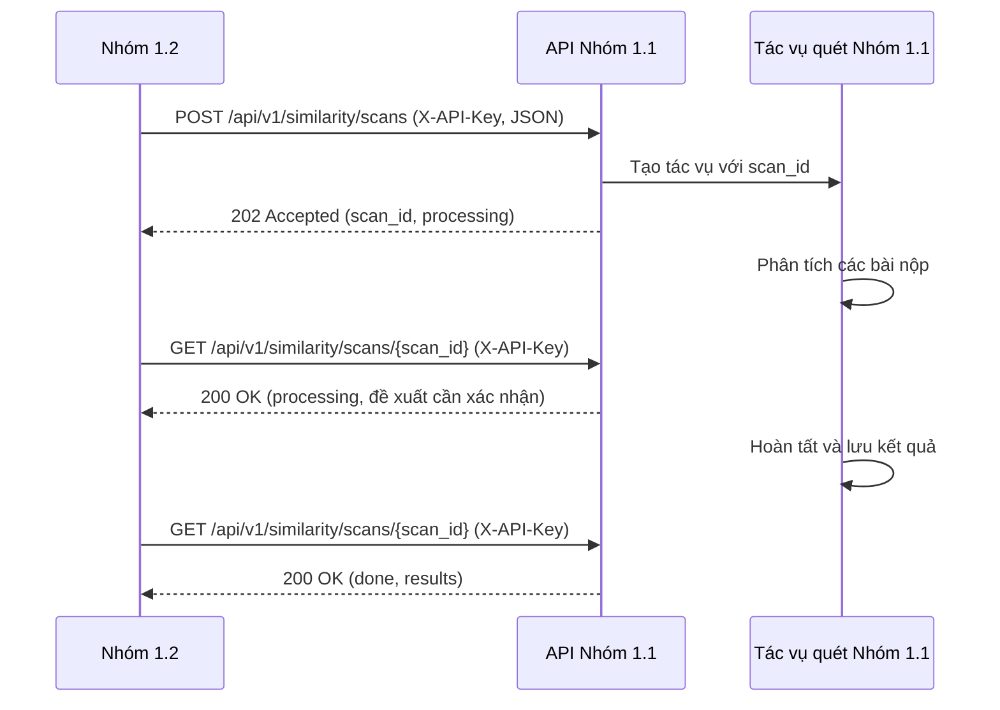

# Đặc tả trao đổi API quét mã tương đồng giữa Nhóm 1.1 và Nhóm 1.2

> **Trạng thái: bản đề xuất để hai nhóm xác nhận.** Tài liệu này cụ thể hóa hai API trong [yêu cầu mentor](../requirments/nhom-1.1-code-similarity-detection.md#2-giao-tiếp-http-api-với-nhóm-12) và các mã HTTP trong ảnh của task. Việc viết tài liệu không xác nhận Nhóm 1.2 đã chấp thuận hoặc backend đã triển khai. Các điểm chưa có căn cứ nằm ở cuối tài liệu; không xem chúng là hợp đồng đã chốt.

## Phạm vi và quy ước chung

- Nhóm 1.2 gọi HTTP API của Nhóm 1.1; mỗi nhóm quản lý database riêng.
- Đường dẫn API có tiền tố `/api/v1/similarity`. Body dùng JSON, tên trường dạng `snake_case`; chuỗi mã nguồn chứa xuống dòng bằng ký tự `\n` khi biểu diễn trong JSON.
- Cả hai API yêu cầu header `X-API-Key`. Khóa thật được trao đổi và lưu bằng kênh cấu hình an toàn, không đưa vào ví dụ hoặc repository. `POST` dùng `Content-Type: application/json`; phản hồi JSON dùng `Content-Type: application/json`.
- Tạo tác vụ quét là bất đồng bộ: `POST` trả `scan_id` ngay sau khi tiếp nhận; Nhóm 1.2 dùng ID đó để gọi `GET` cho đến khi có kết quả. `202` chỉ xác nhận đã nhận yêu cầu, không có nghĩa là đã quét xong.
- [File JSON ví dụ](api-scans-sample.json) gói request và response của cả hai API để có thể parse độc lập. Các trường `method`, `path`, `headers`, `http_status` và `body` trong file ví dụ là **vỏ mô tả HTTP**, không phải các trường trong body thực tế. `REPLACE_WITH_API_KEY` là chỗ thay thế, không phải khóa thật. Điểm số và lời giải thích chỉ minh họa cấu trúc, không phải kết quả từ thuật toán hoặc AI.

### Luồng trao đổi

## 1. Tạo tác vụ quét

`POST /api/v1/similarity/scans`

### Request body

| Trường | Kiểu JSON | Ý nghĩa và ràng buộc |
| --- | --- | --- |
| `assignment_id` | string | ID bài tập do Nhóm 1.2 cung cấp; giữ nguyên để đối chiếu ở hệ thống gửi. |
| `language` | string | Ngôn ngữ chung của các bài trong lần quét; phạm vi MVP là `python` hoặc `cpp` (giá trị `cpp` là quy ước đề xuất, cần hai nhóm xác nhận). |
| `template_code` | string | Mã khung do giảng viên cung cấp để loại khỏi phép so sánh. Quy tắc khi bài tập không có mã khung cần xác nhận. |
| `submissions` | array<object> | Danh sách bài nộp của cùng bài tập; mỗi phần tử có cấu trúc bên dưới. |
| `submissions[].submission_id` | string | ID duy nhất của bài nộp trong lần quét, do Nhóm 1.2 cung cấp; dùng để tham chiếu kết quả và cặp khớp. |
| `submissions[].student_id` | string | ID sinh viên sở hữu bài nộp, do Nhóm 1.2 cung cấp; không phải tên hiển thị. |
| `submissions[].source_code` | string | Toàn bộ nội dung mã nguồn của một file bài nộp. Xem nội dung này là dữ liệu không đáng tin cậy. |

Ví dụ request đầy đủ nằm tại `post_scan.request.body` trong [file JSON](api-scans-sample.json). Giới hạn dung lượng, số bài nộp, cách xử lý ID trùng hoặc chuỗi rỗng chưa được nêu trong tài liệu nguồn và cần chốt trước khi triển khai validation.

### Response khi tiếp nhận

HTTP `202 Accepted`:

| Trường | Kiểu JSON | Ý nghĩa |
| --- | --- | --- |
| `scan_id` | string | ID tác vụ do Nhóm 1.1 tạo; Nhóm 1.2 dùng nguyên giá trị này trong đường dẫn `GET`. |
| `status` | string | Giá trị `processing`: tác vụ đang chờ hoặc đang được xử lý. |

Ví dụ ở `post_scan.response` trong [file JSON](api-scans-sample.json).

## 2. Lấy trạng thái và kết quả

`GET /api/v1/similarity/scans/{scan_id}`

`scan_id` là tham số đường dẫn kiểu string, lấy từ response `POST`; request không có body. `GET` thành công trả HTTP `200 OK`. Khi đã hoàn tất, body có `status: "done"` và `results`:

| Trường | Kiểu JSON | Ý nghĩa |
| --- | --- | --- |
| `scan_id` | string | ID tác vụ được truy vấn; cùng giá trị với response `POST`. |
| `status` | string | `done` khi đã hoàn tất. `processing` khi chưa hoàn tất; hình dạng body lúc này cần xác nhận, xem mục bên dưới. |
| `results` | array<object> | Các kết quả tương đồng của lần quét. Chỉ có trong response hoàn tất theo ví dụ mentor. Quy tắc bài không có cặp khớp cần xác nhận. |
| `results[].submission_id` | string | ID bài nộp đang được báo cáo, tham chiếu `submissions[].submission_id` trong request `POST`. |
| `results[].student_id` | string | ID sinh viên của bài nộp đang được báo cáo, tham chiếu request `POST`. |
| `results[].max_similarity` | number | Độ tương đồng cao nhất của bài nộp này với một bài khác, theo phần trăm từ `0` đến `100`; ví dụ `86.5`. Cách tính điểm chưa được tài liệu nguồn định nghĩa. |
| `results[].matched_with_submission_id` | string | ID bài nộp tạo ra mức tương đồng cao nhất nêu trên. |
| `results[].matched_lines` | array<object> | Các khoảng dòng tương đồng của bài nộp `submission_id`. Cách biểu diễn khoảng dòng của bài được đối chiếu cần xác nhận. |
| `results[].matched_lines[].from_line` | integer | Dòng bắt đầu của khoảng khớp, đánh số từ `1` theo quy ước đề xuất. |
| `results[].matched_lines[].to_line` | integer | Dòng kết thúc, tính cả dòng này; `to_line >= from_line` theo quy ước đề xuất. |
| `results[].ai_explanation` | string | Giải thích ngắn bằng tiếng Việt về điểm giống nhau. Cách thể hiện khi cặp chưa qua AI hoặc AI lỗi cần xác nhận. |
| `results[].risk_level` | string | Mức rủi ro: `low`, `medium` hoặc `high`. Ngưỡng phân mức chưa được tài liệu nguồn định nghĩa. |
| `results[].report_url` | string | URL tuyệt đối đến báo cáo chi tiết của bài nộp trong lần quét, do Nhóm 1.1 cung cấp. Host trong file ví dụ chỉ là tên miền minh họa. |

Ví dụ response hoàn tất ở `get_scan.response` trong [file JSON](api-scans-sample.json). `matched_lines` chỉ chứa tọa độ của bài nộp đang báo cáo theo cách đọc từ tên trường và mẫu mentor; hai nhóm cần xác nhận trước khi dùng tọa độ này để tô màu so sánh hai phía.

### Khi tác vụ còn xử lý

Luồng bất đồng bộ đòi hỏi `GET` có thể được gọi trước khi tác vụ xong. **Đề xuất cần xác nhận:** trả `200 OK` với `scan_id`, `status: "processing"` và chưa có `results`, như `get_scan.processing_response` trong file ví dụ. Chu kỳ hỏi lại, trạng thái tác vụ thất bại và cách xử lý khi quét lỗi chưa được chốt; client không nên suy diễn `done` từ riêng mã HTTP `200`.

## Mã trạng thái HTTP

Các mã và ý nghĩa dưới đây theo ảnh của task. Bảng xác định tình huống ở mức tổng quát; chưa định nghĩa body lỗi hoặc ánh xạ từng trường hợp validation cụ thể.

| HTTP | Tên trạng thái | Trường hợp sử dụng |
| --- | --- | --- |
| `200` | OK | Truy vấn trạng thái hoặc kết quả quét thành công (`GET`). |
| `202` | Accepted | Đã tiếp nhận yêu cầu và tạo tác vụ quét (`POST`). |
| `400` | Bad Request | Dữ liệu đầu vào không hợp lệ. |
| `401` | Unauthorized | Thiếu hoặc sai API key. |
| `403` | Forbidden | Đã xác thực nhưng không có quyền truy cập tài nguyên. |
| `404` | Not Found | Không tìm thấy `scan_id`. |
| `409` | Conflict | Yêu cầu xung đột với dữ liệu hoặc trạng thái hiện tại. |
| `413` | Content Too Large | Dung lượng request vượt giới hạn. |
| `415` | Unsupported Media Type | Định dạng request không được hỗ trợ. |
| `429` | Too Many Requests | Gửi quá nhiều request trong thời gian ngắn. |
| `500` | Internal Server Error | Lỗi không mong muốn khi xử lý HTTP request. |
| `503` | Service Unavailable | Hệ thống tạm thời không thể tiếp nhận hoặc phục vụ yêu cầu. |

## Các điểm cần hai nhóm chốt trước khi coi là hợp đồng cuối

1. Tên giá trị cho C++ trong `language`; `template_code` bắt buộc hay tùy chọn, và cách biểu diễn trường hợp không có mã khung.
2. Giới hạn kích thước, số bài nộp, quy tắc ID và nội dung rỗng; điều kiện cụ thể cho `400`, `409`, `413`, `429`.
3. Body JSON của lỗi và trạng thái tác vụ thất bại; body `GET` khi còn `processing`, chu kỳ polling và thời hạn lưu `scan_id`.
4. Quy tắc `results` cho bài không có cặp khớp, hòa điểm cao nhất, cặp chưa qua AI hoặc AI lỗi; ngưỡng `risk_level` và cách tính `max_similarity`.
5. Tọa độ `matched_lines` đối với cả hai bài, quy ước dòng và cách hiển thị báo cáo ở `report_url`.

Sau khi Nhóm 1.1 và Nhóm 1.2 xác nhận những điểm này, cập nhật tài liệu và file JSON ví dụ cùng nhau trước khi triển khai hoặc tích hợp.
